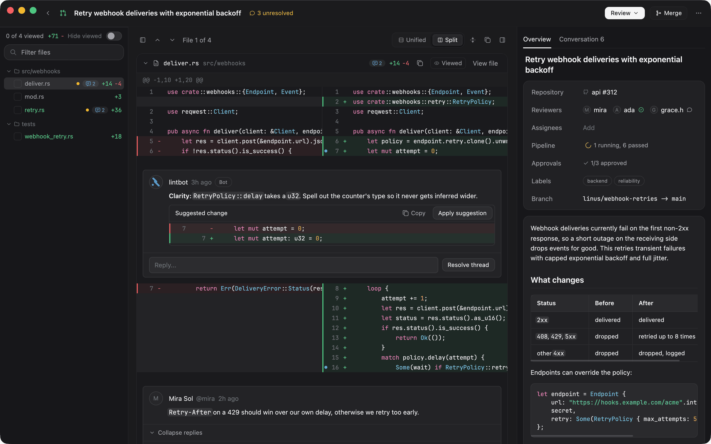
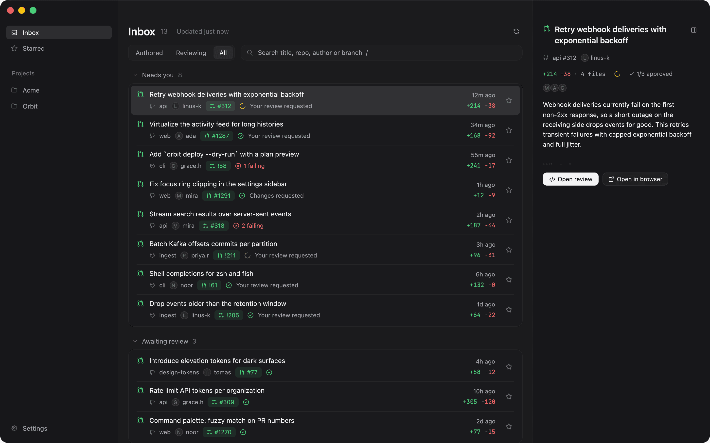
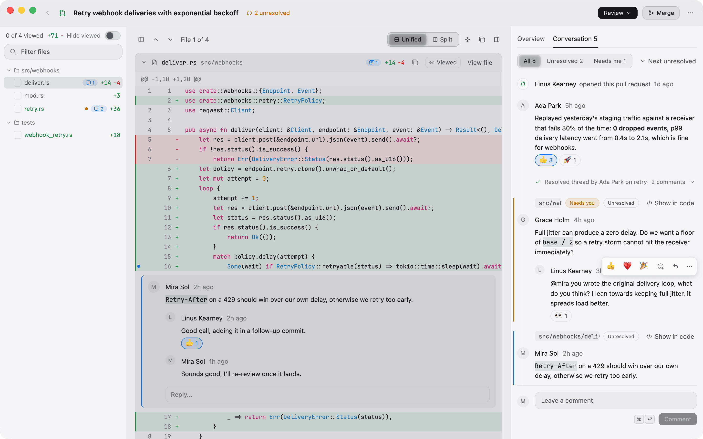
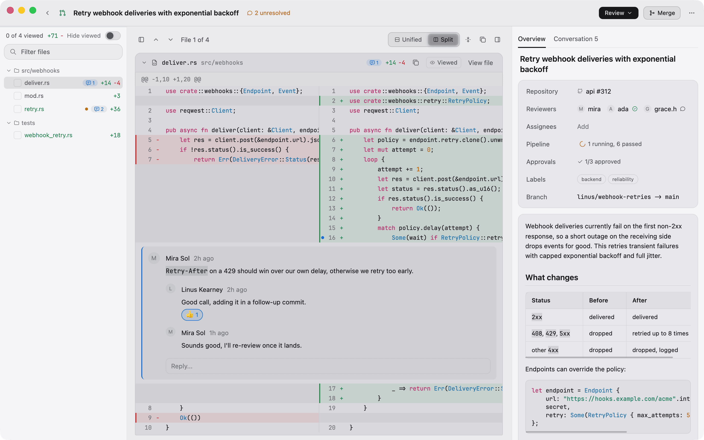
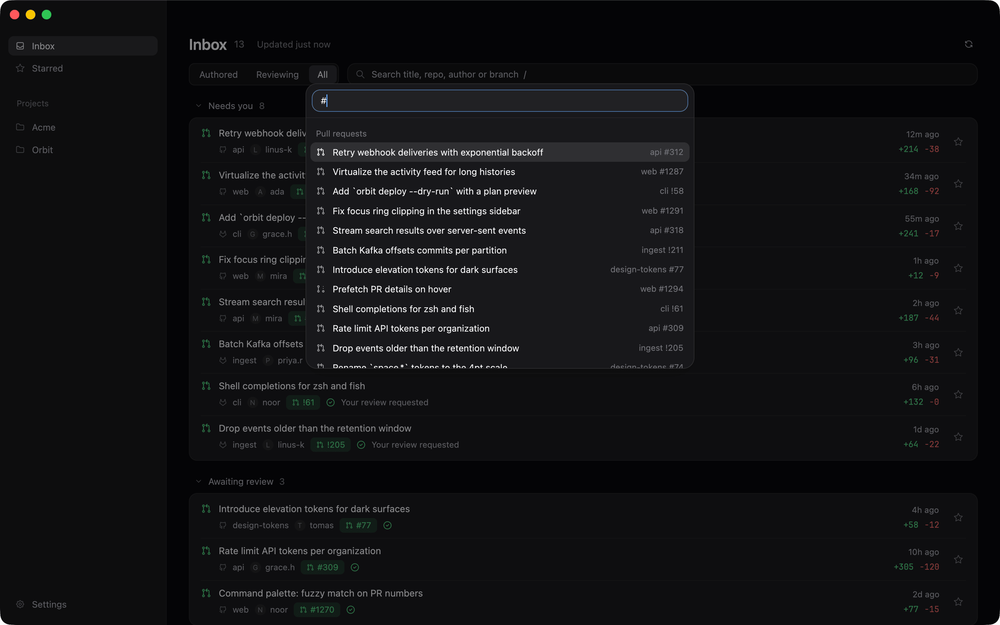

<p align="center"></p>

<h1 align="center">Confluo</h1>

<p align="center">Every pull request, one calm place.<br>GitHub, GitLab and Azure DevOps in a native macOS app.</p>

<p align="center"></p>

## Features

- **One inbox across providers.** Pull and merge requests that need you, from GitHub, GitLab and Azure DevOps, sorted by what to do next.
- **Focused review mode.** Unified or split diffs, a file tree with viewed state, checks and the PR overview side by side.
- **Inline comments.** Start threads on a line or range, reply, react, resolve, and jump to the next thread that needs you.
- **Keyboard and gestures.** A command palette for everything, shortcuts on every action, trackpad swipes between list and review.
- **Native macOS.** Built in Rust on GPUI: fast, light, and it uses your existing `gh`, `glab` and `az` logins. No tokens to paste.

## Gallery

| | |
| --- | --- |
|  |  |
|  |  |

## Install

Download the latest `Confluo-X.Y.Z.dmg` from [Releases](https://github.com/nomomon/confluo/releases/latest), open it and drag Confluo to Applications.

Or build from source (Rust stable, macOS 12+):

```sh
scripts/install-macos.sh
```

### Linux

From the same release page (x86_64 and aarch64):

- AppImage: `chmod +x Confluo-X.Y.Z-x86_64.AppImage` and run it (needs `libfuse2`). Updates itself.
- Debian/Ubuntu: `sudo apt install ./confluo_X.Y.Z-1_amd64.deb`. Update by installing the newer `.deb`.
- Tarball: `Confluo-X.Y.Z-linux-x86_64.tar.gz` holds the `confluo` binary, a desktop entry and the icon.

Shortcuts use Ctrl where macOS uses Cmd. There is no global menu bar; every command is in the palette (Ctrl+K).

## Update

Confluo checks for new releases on launch and every few hours, and updates itself in place after verifying the download (on Linux only the AppImage; other installs get a link to the release). Turn it off in Settings > General.

## License

MIT, see [LICENSE](LICENSE).

---

[Development](docs/development.md) · [Releasing](docs/releasing.md) · [Design system](docs/design-system.md) · [Brand](docs/brand.md)
